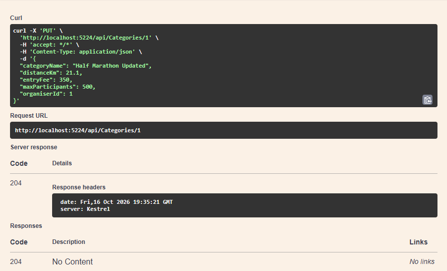
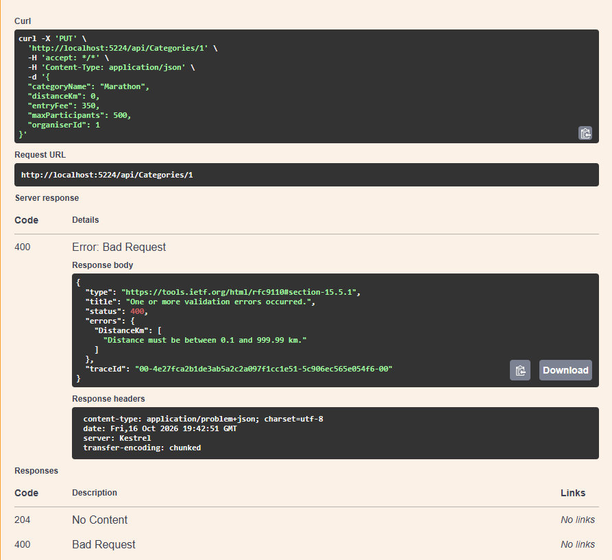
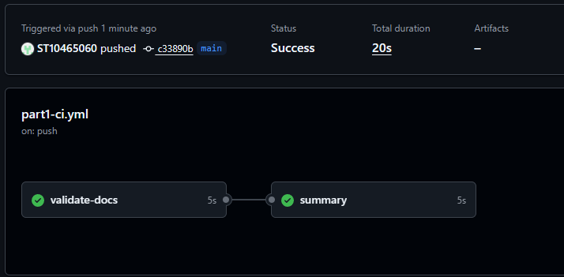

# RaceDay – Event Management System
**PROG6212 Portfolio of Evidence – Parts 1 and 2**

Student: Eduan Pretorius
Student Number: ST10465060

## Contents
- [System Overview](#system-overview)
- [User Roles](#user-roles)
- [Repository Structure](#repository-structure)
- [Part 1 – Planning Artefacts](#part-1--planning-artefacts)
- [Database Setup Instructions](#database-setup-instructions)
- [Part 2 – API Implementation](#part-2--api-implementation)
- [Running the API](#running-the-api)
- [Event Endpoints](#event-endpoints)
- [Category Endpoints](#category-endpoints)
- [Response Codes Used](#response-codes-used)
- [Testing Evidence](#testing-evidence)
- [CI/CD Status](#cicd-status)
- [Video Demonstration](#video-demonstration)
- [References](#references)

## System Overview
RaceDay is a web-based race event management system. Organisers publish running
events with multiple distance categories, manage entrants and capture results,
while participants browse events, enter a category and track their own results.

Part 1 covered the planning phase: the entity relationship diagram, the RESTful
API endpoint plan and the SQL Server database script. Part 2 implements that
plan as an ASP.NET Core Web API using Entity Framework Core with a code-first
approach.

## User Roles
**Organiser** – creates and maintains events, defines the distance categories for
each event, views the entrant list for their events and captures finish times
and positions.

**Participant** – registers an account, browses published events, enters a chosen
category, views and withdraws from their own enrolments and views their results.

## Repository Structure

```
PROG6212-RaceDayPOE-EduanP-ST10465060/
│
├── .github/
│ └── workflows/
│ └── part1-ci.yml
│
├── docs/
│ ├── RaceDay_ERD.pdf
│ ├── RaceDay_API_Endpoint_Plan.pdf
│ ├── RaceDay_Database.sql
│ ├── cicd-green-build.png
│ └── screenshots/
│
├── src/
│ ├── RaceDay.Api/
│ │ ├── Controllers/
│ │ ├── Data/
│ │ └── Models/
│ └── RaceDay.Contracts/
│
└── README.md
```
## Part 1 – Planning Artefacts
**Entity Relationship Diagram** – seven entities: `Roles`, `Users`, `Venues`,
`Events`, `Categories`, `Enrolments` and `Results`. The many-to-many
relationship between participants and categories is resolved by the
`Enrolments` junction entity, and `Enrolments` to `Results` is one-to-one.

**API Endpoint Plan** – 21 endpoints across authentication, user profiles,
events, categories, enrolments and results. Each entry documents the HTTP
method, route, description, required role, request body and expected response
codes.

**Database Script** – creates `RaceDayDB` and its seven tables with all primary
key, foreign key, unique, default and check constraints, then seeds two
organisers, two participants, three venues, three events, seven categories,
four enrolments and two results.

### ERD and Script Consistency
Every entity, attribute and relationship shown in the ERD appears in the SQL
script with the same name, data type and constraint. The foreign keys in the
script mirror the crow's-foot relationships in the diagram exactly, so the two
artefacts describe a single design rather than two competing ones.

## Database Setup Instructions
**Prerequisites:** SQL Server 2019 or later and SQL Server Management Studio.
The script uses `DATETIME2` and `SYSUTCDATETIME()`.

### Part 1 – manual script
1. Open SQL Server Management Studio and connect to your local instance.
2. Open `docs/RaceDay_Database.sql`.
3. Execute the script in full (F5). It drops any existing `RaceDayDB`,
   recreates the seven tables with all constraints and inserts the seed data.
4. The verification query at the end returns four rows joining `Enrolments` to
   `Users`, `Categories` and `Events`, confirming that the seed data and
   foreign keys resolve correctly.

The script is idempotent and may be re-run repeatedly from a clean state.

### Part 2 – EF Core migrations
Part 2 does not use the Part 1 script. The database is generated from the C#
entity classes through EF Core migrations, which is why the Part 2 database is
named `RaceDayPart2` rather than `RaceDayDB`. Keeping the two separate means
the Part 1 artefact stays untouched for marking while Part 2 continues to
evolve.

```bash
dotnet ef database update --project src/RaceDay.Api
```

## Part 2 – API Implementation
The solution is split into two projects so that responsibilities stay separate:

| Project | Responsibility |
|--------------------|-------------------------------------------------------------------|
| `RaceDay.Api` | Controllers, EF Core `DbContext`, entity models, Swagger configuration |
| `RaceDay.Contracts` | Request objects (DTOs) with validation attributes |

Request objects are deliberately kept apart from the entity models. A client
should never be able to set a primary key or a navigation property simply by
including it in a JSON body, so each endpoint accepts a purpose-built contract
and the controller maps that contract onto the entity.

**Technology stack:** .NET 8, ASP.NET Core Web API, Entity Framework Core,
SQL Server, Swashbuckle (Swagger UI).

## Running the API
```bash
dotnet build
dotnet run --project src/RaceDay.Api --launch-profile http
```

Swagger UI is then available at `http://localhost:5224/swagger`.

## Event Endpoints

| Method | Route | Purpose |
|--------|---------------------|---------------------------|
| GET | `/api/Events` | List all events |
| GET | `/api/Events/{id}` | Retrieve a single event |
| POST | `/api/Events` | Create an event |
| PUT | `/api/Events/{id}` | Update an event |
| DELETE | `/api/Events/{id}` | Remove an event |

## Category Endpoints
Categories are the individual races inside an event, for example a 5 km Fun Run
within a night series. Read operations are nested under the parent event,
because a category has no meaning on its own. Update and delete use a flat
route, since by that point the category ID alone identifies the record.

| Method | Route | Purpose |
|--------|------------------------------------------------------|-----------------------------------|
| GET | `/api/Events/{eventId}/Categories` | List all categories for an event |
| GET | `/api/Events/{eventId}/Categories/{categoryId}` | Retrieve a single category |
| PUT | `/api/Categories/{id}` | Update an existing category |
| DELETE | `/api/Categories/{id}?organiserId={organiserId}` | Remove a category |

### Request body – PUT /api/Categories/{id}
```json
{
  "categoryName": "Fun Run",
  "distanceKm": 5,
  "entryFee": 80,
  "maxParticipants": 1200,
  "organiserId": 1
}
```

### Validation rules

| Field | Rule |
|-------------------|--------------------------------------|
| `categoryName` | Required, 2-80 characters |
| `distanceKm` | 0.1 - 999.99 |
| `entryFee` | 0 - 100000 |
| `maxParticipants` | 1 - 10000 |
| `organiserId` | Required, must own the parent event |

Decimal ranges use the `Range(double, double)` overload with an explicit
`ErrorMessage`, so validation behaves identically regardless of the server's
regional settings. This matters on a South African machine, where the default
decimal separator is a comma rather than a full stop.

### Business rules
These rules are enforced inside the controller rather than by attributes,
because they depend on the current state of the database:

| # | Rule | Enforcement |
|---|---------------------|--------------------------------------------------------------------------------|
| 1 | Ownership | Only the organiser who owns the parent event may update or delete its categories, otherwise `403 Forbidden` |
| 2 | Capacity floor | `maxParticipants` cannot drop below the number already enrolled, otherwise `400 Bad Request` |
| 3 | Delete protection | A category that has enrolments cannot be deleted, otherwise `409 Conflict` |

The capacity floor exists because lowering the maximum below the enrolled count
would leave confirmed entrants in an over-subscribed race. Delete protection
exists to prevent orphaned enrolment records pointing at a category that no
longer exists.

## Response Codes Used

| Code | Meaning | Triggered by |
|------|---------------------------------------|--------------------------------------------------------|
| 200 OK | Data returned | Successful GET |
| 201 Created | Resource created | Successful POST |
| 204 No Content | Change applied, nothing to return | Successful PUT or DELETE |
| 400 Bad Request | Input rejected | Failed validation, or capacity below enrolled count |
| 403 Forbidden | Caller not permitted | `organiserId` does not own the parent event |
| 404 Not Found | Record does not exist | Unknown ID |
| 409 Conflict | Request valid but state forbids it | Deleting a category that has enrolments |

The distinction between 400 and 409 is deliberate. A 400 means the request
itself was wrong; a 409 means the request was well-formed but the current state
of the data will not allow it. Returning 400 for both would hide a meaningful
difference from the client.

## Testing Evidence
All endpoints were tested through Swagger UI against the `RaceDayPart2`
database. Each screenshot captures the Curl command, the Request URL and the
live server response, rather than the generated documentation table.

| Screenshot | Scenario | Result |
|--------------------------------------|------------------------------------------------|------------------|
| `10-category-put-204.png` | Valid update by the owning organiser | 204 No Content |
| `12-category-put-400-validation.png` | Distance outside the permitted range | 400 Bad Request |
| `13-category-put-400-capacity.png` | Maximum lowered below the enrolled count | 400 Bad Request |
| `15-category-delete-204.png` | Delete a category with no enrolments | 204 No Content |





## CI/CD Status


## Video Demonstration
[RaceDay Part 1 walkthrough (unlisted)](https://www.youtube.com/watch?v=snwTFKWFB7E)

The recording covers the ERD and its relationships, a walkthrough of the API
endpoint plan, a live execution of the database script in SSMS, and the commit
history and CI/CD workflow in GitHub.

## References
Microsoft. 2026. *Entity Framework Core documentation*. [Online]. Available at:
https://learn.microsoft.com/en-us/ef/core/ [Accessed 14 October 2026].

Troelsen, A. & Japikse, P. 2022. *Pro C# 10 with .NET 6: Foundational
Principles and Practices in Programming*. 11th ed. Berkeley: Apress.

W3Schools. 2026. *SQL Tutorial*. [Online]. Available at:
https://www.w3schools.com/sql/ [Accessed 31 August 2026].
