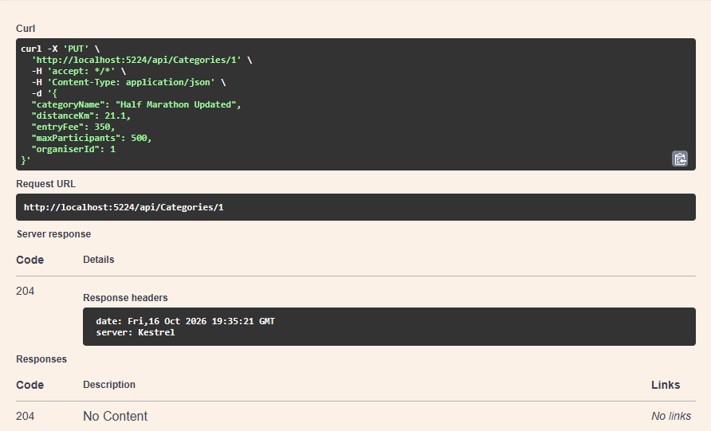
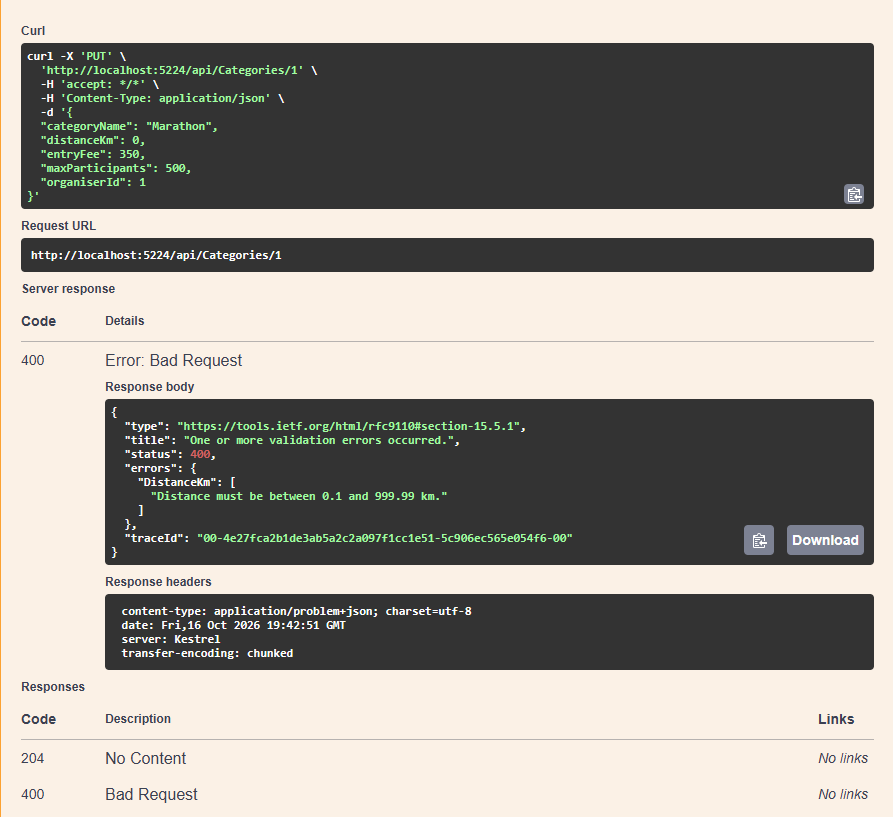
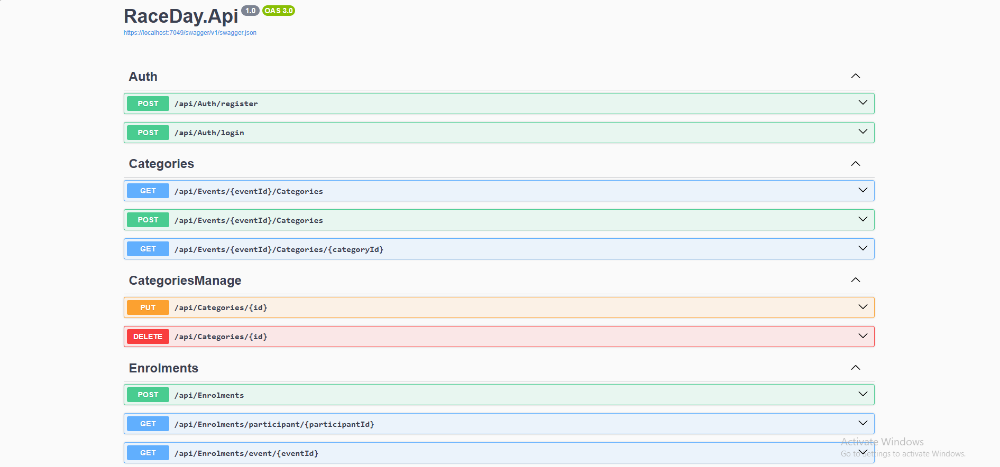
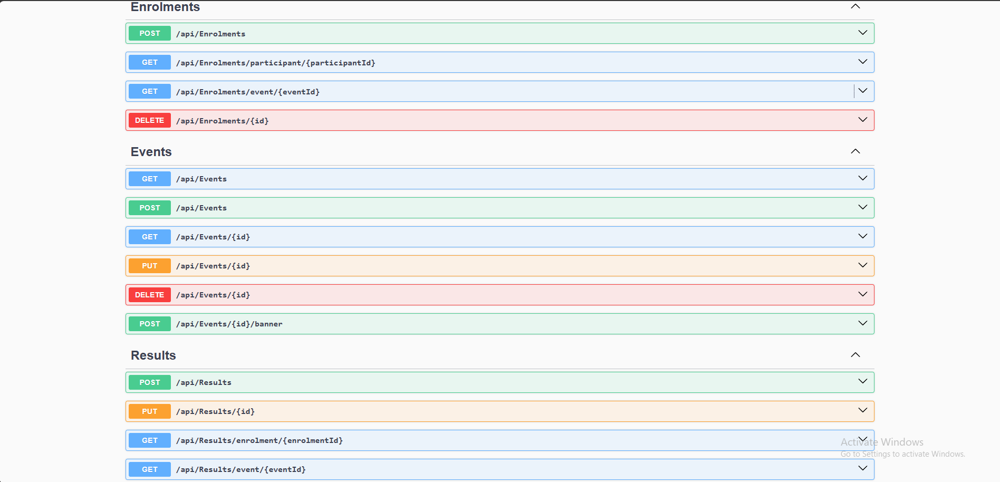
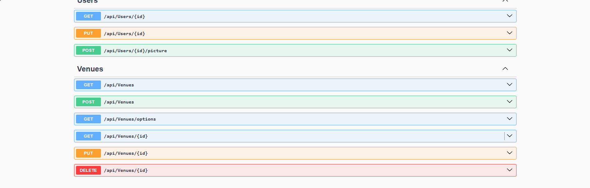
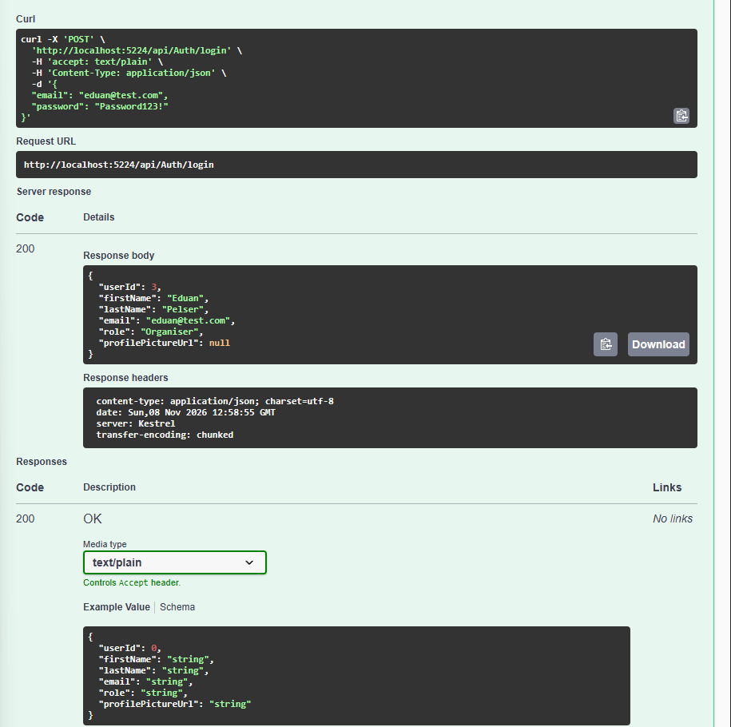
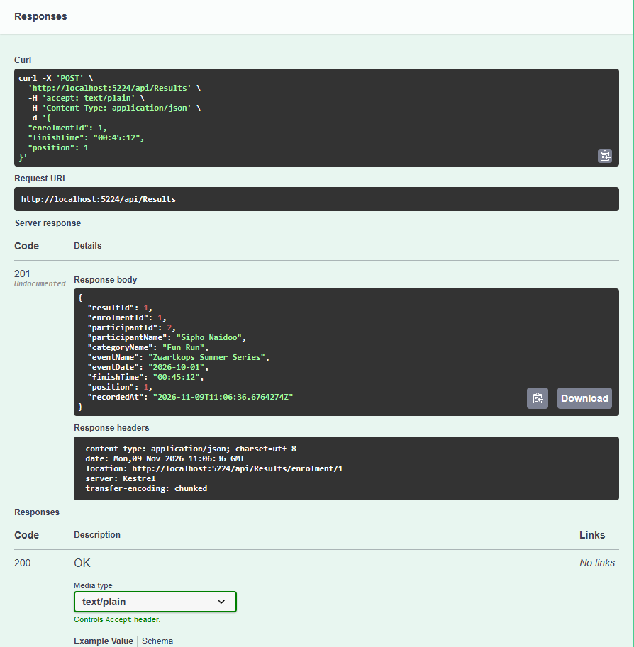
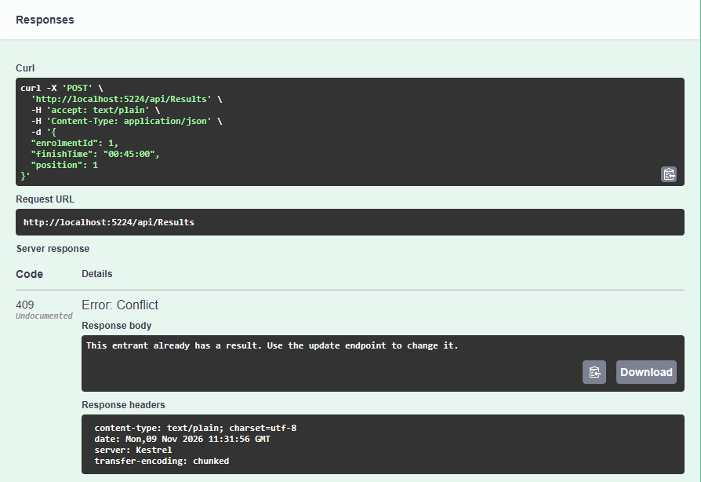
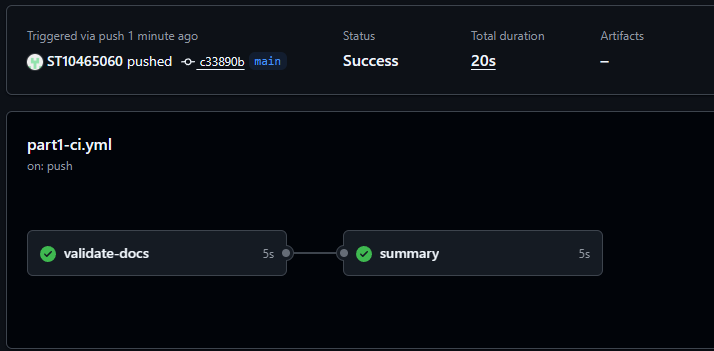

 RaceDay – Event Management System
**PROG6212 Portfolio of Evidence – Parts 1, 2 and 3**

Student: Eduan Pretorius
Student Number: ST10465060
Branch: `part-3`

## Contents
- [System Overview](#system-overview)
- [User Roles](#user-roles)
- [Repository Structure](#repository-structure)
- [Part 1 – Planning Artefacts](#part-1--planning-artefacts)
- [Database Setup Instructions](#database-setup-instructions)
- [Part 2 – API Implementation](#part-2--api-implementation)
- [Running the API](#running-the-api)
- [Event Endpoints](#event-endpoints)
- [Category Endpoints](#category-endpoints)
- [Response Codes Used](#response-codes-used)
- [Part 3 – MVC Web Application](#part-3--mvc-web-application)
- [Running the Web Application](#running-the-web-application)
- [Running in Docker](#running-in-docker)
- [Test Accounts](#test-accounts)
- [Authentication and Session Management](#authentication-and-session-management)
- [Organiser Features](#organiser-features)
- [Participant Features](#participant-features)
- [Azure Blob Storage Integration](#azure-blob-storage-integration)
- [API Endpoints Consumed](#api-endpoints-consumed)
- [Business Rules Enforced by the API](#business-rules-enforced-by-the-api)
- [Error Handling](#error-handling)
- [Testing Evidence](#testing-evidence)
- [CI/CD Status](#cicd-status)
- [Video Demonstration](#video-demonstration)
- [References](#references)

## System Overview
RaceDay is a web-based race event management system. Organisers publish running
events with multiple distance categories, manage entrants and capture results,
while participants browse events, enter a category and track their own results.

Part 1 covered the planning phase: the entity relationship diagram, the RESTful
API endpoint plan and the SQL Server database script. Part 2 implements that
plan as an ASP.NET Core Web API using Entity Framework Core with a code-first
approach. Part 3 adds the ASP.NET Core MVC front end that consumes that API,
integrates Azure Blob Storage for image uploads and containerises the web
application with Docker.

## User Roles
**Organiser** – creates and maintains events, defines the distance categories for
each event, uploads an event banner image, views the entrant list for their
events and captures finish times and positions.

**Participant** – registers an account, browses published events, enters a chosen
category, views and withdraws from their own enrolments and views their results.

## Repository Structure

```
PROG6212-RaceDayPOE-EduanP-ST10465060/
│
├── .github/
│   └── workflows/
│       └── part1-ci.yml
│
├── docs/
│   ├── RaceDay_ERD.pdf
│   ├── RaceDay_API_Endpoint_Plan.pdf
│   ├── RaceDay_Database.sql
│   ├── cicd-green-build.png
│   └── screenshots/
│
├── src/
│   ├── RaceDay.Api/
│   │   ├── Controllers/
│   │   ├── Data/
│   │   ├── Models/
│   │   └── Services/
│   ├── RaceDay.Contracts/
│   └── RaceDay.Web/
│       ├── Controllers/
│       ├── Services/
│       ├── Views/
│       ├── wwwroot/
│       └── Dockerfile
│
├── .dockerignore
└── README.md
```

## Part 1 – Planning Artefacts
**Entity Relationship Diagram** – seven entities: `Roles`, `Users`, `Venues`,
`Events`, `Categories`, `Enrolments` and `Results`. The many-to-many
relationship between participants and categories is resolved by the
`Enrolments` junction entity, and `Enrolments` to `Results` is one-to-one.

**API Endpoint Plan** – 21 endpoints across authentication, user profiles,
events, categories, enrolments and results. Each entry documents the HTTP
method, route, description, required role, request body and expected response
codes.

**Database Script** – creates `RaceDayDB` and its seven tables with all primary
key, foreign key, unique, default and check constraints, then seeds two
organisers, two participants, three venues, three events, seven categories,
four enrolments and two results.

### ERD and Script Consistency
Every entity, attribute and relationship shown in the ERD appears in the SQL
script with the same name, data type and constraint. The foreign keys in the
script mirror the crow's-foot relationships in the diagram exactly, so the two
artefacts describe a single design rather than two competing ones.

## Database Setup Instructions
**Prerequisites:** SQL Server 2019 or later and SQL Server Management Studio.
The script uses `DATETIME2` and `SYSUTCDATETIME()`.

### Part 1 – manual script
1. Open SQL Server Management Studio and connect to your local instance.
2. Open `docs/RaceDay_Database.sql`.
3. Execute the script in full (F5). It drops any existing `RaceDayDB`,
   recreates the seven tables with all constraints and inserts the seed data.
4. The verification query at the end returns four rows joining `Enrolments` to
   `Users`, `Categories` and `Events`, confirming that the seed data and
   foreign keys resolve correctly.

The script is idempotent and may be re-run repeatedly from a clean state.

### Parts 2 and 3 – EF Core migrations
Parts 2 and 3 do not use the Part 1 script. The database is generated from the
C# entity classes through EF Core migrations, which is why it is named
`RaceDayPart2` rather than `RaceDayDB`. Keeping the two separate means the
Part 1 artefact stays untouched for marking while the later parts continue to
evolve.

```bash
dotnet ef database update --project src/RaceDay.Api
```

## Part 2 – API Implementation
The solution is split into three projects so that responsibilities stay
separate:

| Project | Responsibility |
|--------------------|-------------------------------------------------------------------|
| `RaceDay.Api` | Controllers, EF Core `DbContext`, entity models, Blob Storage service, Swagger configuration |
| `RaceDay.Contracts` | Request and response objects (DTOs) with validation attributes |
| `RaceDay.Web` | MVC controllers, Razor views, typed API client and session handling |

Request objects are deliberately kept apart from the entity models. A client
should never be able to set a primary key or a navigation property simply by
including it in a JSON body, so each endpoint accepts a purpose-built contract
and the controller maps that contract onto the entity.

`RaceDay.Contracts` is referenced by both applications, so the shape of a
request or response cannot drift between them. Renaming a property on the API
side breaks the build in the MVC project rather than silently deserialising a
null at runtime.

**Technology stack:** .NET 8, ASP.NET Core Web API, ASP.NET Core MVC, Entity
Framework Core, SQL Server, Azure Blob Storage, Swashbuckle (Swagger UI),
Docker.

## Running the API
```bash
dotnet build
dotnet run --project src/RaceDay.Api --launch-profile http
```

Swagger UI is then available at `http://localhost:5224/swagger`.

## Event Endpoints

| Method | Route | Purpose |
|--------|---------------------------|------------------------------|
| GET | `/api/Events` | List all events |
| GET | `/api/Events/{id}` | Retrieve a single event |
| POST | `/api/Events` | Create an event |
| PUT | `/api/Events/{id}` | Update an event |
| DELETE | `/api/Events/{id}` | Remove an event |
| POST | `/api/Events/{id}/banner` | Upload an event banner image |

The list endpoint accepts optional query parameters, for example
`GET /api/Events?status=Published&eventType=Road Running`. The public race list
always passes `status=Published`, so a draft event is filtered out in SQL
rather than being fetched and then hidden in the view. An organiser's
management page passes `organiserId` instead, which means another organiser's
drafts never travel over the wire at all.

## Category Endpoints
Categories are the individual races inside an event, for example a 5 km Fun Run
within a night series. Read operations are nested under the parent event,
because a category has no meaning on its own. Update and delete use a flat
route, since by that point the category ID alone identifies the record.

| Method | Route | Purpose |
|--------|------------------------------------------------------|-----------------------------------|
| GET | `/api/Events/{eventId}/Categories` | List all categories for an event |
| GET | `/api/Events/{eventId}/Categories/{categoryId}` | Retrieve a single category |
| PUT | `/api/Categories/{id}` | Update an existing category |
| DELETE | `/api/Categories/{id}?organiserId={organiserId}` | Remove a category |

### Request body – PUT /api/Categories/{id}
```json
{
  "categoryName": "Fun Run",
  "distanceKm": 5,
  "entryFee": 80,
  "maxParticipants": 1200,
  "organiserId": 1
}
```

### Validation rules

| Field | Rule |
|-------------------|--------------------------------------|
| `categoryName` | Required, 2-80 characters |
| `distanceKm` | 0.1 - 999.99 |
| `entryFee` | 0 - 100000 |
| `maxParticipants` | 1 - 10000 |
| `organiserId` | Required, must own the parent event |

Decimal ranges use the `Range(double, double)` overload with an explicit
`ErrorMessage`, so validation behaves identically regardless of the server's
regional settings. This matters on a South African machine, where the default
decimal separator is a comma rather than a full stop.

### Business rules
These rules are enforced inside the controller rather than by attributes,
because they depend on the current state of the database:

| # | Rule | Enforcement |
|---|---------------------|--------------------------------------------------------------------------------|
| 1 | Ownership | Only the organiser who owns the parent event may update or delete its categories, otherwise `403 Forbidden` |
| 2 | Capacity floor | `maxParticipants` cannot drop below the number already enrolled, otherwise `400 Bad Request` |
| 3 | Delete protection | A category that has enrolments cannot be deleted, otherwise `409 Conflict` |

The capacity floor exists because lowering the maximum below the enrolled count
would leave confirmed entrants in an over-subscribed race. Delete protection
exists to prevent orphaned enrolment records pointing at a category that no
longer exists.

## Response Codes Used

| Code | Meaning | Triggered by |
|------|---------------------------------------|--------------------------------------------------------|
| 200 OK | Data returned | Successful GET |
| 201 Created | Resource created | Successful POST |
| 204 No Content | Change applied, nothing to return | Successful PUT or DELETE |
| 400 Bad Request | Input rejected | Failed validation, or capacity below enrolled count |
| 403 Forbidden | Caller not permitted | `organiserId` does not own the parent event |
| 404 Not Found | Record does not exist | Unknown ID |
| 409 Conflict | Request valid but state forbids it | Duplicate enrolment, a full category, or deleting a category that has enrolments |

The distinction between 400 and 409 is deliberate. A 400 means the request
itself was wrong; a 409 means the request was well-formed but the current state
of the data will not allow it. Returning 400 for both would hide a meaningful
difference from the client.

## Part 3 – MVC Web Application
Part 3 adds `RaceDay.Web`, an ASP.NET Core MVC application that sits in front
of the Part 2 API. Organisers sign in to create events, define distance
categories and upload a banner image. Participants sign in to browse published
races, view full event detail with live remaining capacity, enter a category
and withdraw again.

The request flow is:

```
Browser  ->  RaceDay.Web (MVC)  ->  RaceDay.Api  ->  SQL Server
                                         │
                                         └──────>  Azure Blob Storage
```

The MVC project contains no `DbContext`, no Entity Framework reference and no
Azure SDK reference. Every read and write goes through a single typed
`ApiClient` service. This keeps the business rules in exactly one place so they
cannot disagree between clients, and keeps the database connection string and
the storage credentials out of the front end entirely.

| Component | Responsibility |
|---------------|----------------------------------------------------------------|
| `ApiClient` | Typed HTTP wrapper around every API call, including file uploads |
| `CurrentUser` | Reads the logged-in user ID, name and role out of session |
| Controllers | Translate a browser request into an API call and choose a view |
| Views | Razor markup only, with no data access of any kind |

`ApiClient` is registered with `AddHttpClient`, which gives it a pooled message
handler managed by the framework. Creating a `new HttpClient()` per request is
the common mistake here and leads to socket exhaustion under load.

## Running the Web Application
Azurite must be running first, because the API resolves its Blob Storage
container at startup:

```bash
docker run -d --name azurite -p 10000:10000 -p 10001:10001 -p 10002:10002 mcr.microsoft.com/azure-storage/azurite:3.29.0
```

Start the API, then in a second terminal start the web application:

```bash
dotnet run --project src/RaceDay.Api --launch-profile http
dotnet run --project src/RaceDay.Web
```

Open the URL printed in the console. The API must stay running, because the web
application holds no data of its own.

The API base address is read from `ApiSettings:BaseUrl` in `appsettings.json`
rather than being hardcoded. That single decision is what allows the Docker
container to be pointed at a different API without rebuilding the image.

## Running in Docker
The MVC application is containerised with a multi-stage Dockerfile. The build
stage uses the .NET SDK image to publish the application, and only the
published output is copied into the smaller ASP.NET runtime image, so no source
code or build tooling ships in the final container. The container runs as the
built-in non-root user.

Build the image from the repository root. The trailing dot is the build context
and is required:

```bash
docker build -t raceday-web -f src/RaceDay.Web/Dockerfile .
```

With Azurite and the API already running on the host, start the container:

```bash
docker run -d -p 8080:8080 --name raceday-web -e ApiSettings__BaseUrl=http://host.docker.internal:5224/ raceday-web
```

The application is then available at `http://localhost:8080`.

`host.docker.internal` is Docker Desktop's alias for the host machine. Inside a
container `localhost` refers to the container itself, so that hostname is what
allows the containerised front end to reach the API running outside it. The
double underscore in `ApiSettings__BaseUrl` is how ASP.NET Core maps an
environment variable onto the nested `ApiSettings:BaseUrl` configuration key,
which is why no rebuild is needed to retarget the API.

A `.dockerignore` file in the repository root excludes `bin`, `obj`, `.vs` and
`.git` from the build context. Without it the build is slow, and stale Windows
build output can confuse the Linux restore.

```bash
docker logs raceday-web
docker stop raceday-web
docker rm raceday-web
```

## Test Accounts

| Role | Email | Password |
|-------------|------------------|--------------|
| Organiser | eduan@test.com | Password123! |
| Participant | sipho@test.com | Password123! |

New accounts can also be registered through the web application, choosing
either role on the registration form.

## Authentication and Session Management
Registration and login are posted to `/api/Auth/register` and
`/api/Auth/login`. The API hashes passwords using PBKDF2 with a per-user random
salt, so two users with the same password produce different hashes and a stolen
database does not yield usable credentials.

| Concern | Handling |
|-------------------|-------------------------------------------------------|
| Password storage | PBKDF2 with a per-user salt, performed by the API |
| Logged-in state | Session, holding the user ID, display name and role |
| Protected pages | The controller checks the session and redirects to login |
| Menu rendering | Driven by the role held in session |
| Logout | Clears the session in full |

A `CurrentUser` helper service reads the session values, which keeps session key
strings out of the controllers and views. Because protected actions check the
session in the controller rather than only hiding links, a bookmarked URL
cannot be used to skip the login. The navigation menu is built from the role, so
an Organiser and a Participant see genuinely different menus rather than the
same menu with items hidden.

## Organiser Features
- Create, edit and delete events, capturing name, description, date, venue,
  distance, event type and status.
- Add entry categories to an event, each with its own distance, entry fee and
  participant limit.
- Upload a banner image for an event, stored in Azure Blob Storage and shown on
  the event detail page.
- Draft events are visible only to their owner.

An organiser's management list passes `organiserId` to the API, so the filtering
happens in SQL. Another organiser's drafts are never fetched at all, rather than
being fetched and then hidden in the view.

## Participant Features
- Browse published events, with keyword search and event type filtering.
- View full event detail, with the remaining spaces in each category calculated
  live from the current enrolment count.
- Enter a chosen category, and withdraw again if plans change.
- My Races, listing every entry with its current status.

The public race list always passes `status=Published`, which means a draft or
cancelled event cannot reach the browse page even if a participant knows the
event ID.

## Azure Blob Storage Integration
Image uploads follow a deliberate path so that the MVC application never
contacts Azure directly:

1. The browser posts the file to the MVC application as `multipart/form-data`.
2. The MVC controller streams it to the API using `MultipartFormDataContent`.
3. The API validates the content type and size, writes the blob to the
   container and saves the returned URL against the record.
4. The MVC view renders the stored URL.

| Concern | Handling |
|-----------------------|---------------------------------------------------|
| Where the file lands | Azure Blob Storage, emulated locally by Azurite |
| Who writes the blob | `RaceDay.Api` only |
| What is stored in SQL | The blob URL, not the bytes |
| Allowed content types | JPEG and PNG |
| Upload transport | `multipart/form-data` |

The upload could not reuse the existing `PostAsync` method on `ApiClient`,
because JSON cannot carry binary content. A separate `PostFileAsync` method
builds a `MultipartFormDataContent` body instead. The form field name must
match the `IFormFile` parameter name on the API action exactly, otherwise model
binding supplies a null without raising an error, which makes the failure look
like a server fault rather than a naming mismatch.

Storing the URL rather than the bytes keeps the database small and means the
image is served directly by the storage account instead of through the
application, which is the pattern a production deployment would use. Moving
from Azurite to a real Azure Storage account requires only a connection string
change, with no change to code.

## API Endpoints Consumed
Every endpoint below is called by `RaceDay.Web` through `ApiClient`. All are
documented and testable in Swagger at `http://localhost:5224/swagger`.

| Area | Endpoints |
|-------------|-----------------------------------------------------------------|
| Auth | `POST /api/Auth/register`, `POST /api/Auth/login` |
| Events | `GET /api/Events`, `GET /api/Events/{id}`, `POST /api/Events`, `PUT /api/Events/{id}`, `DELETE /api/Events/{id}`, `POST /api/Events/{id}/banner` |
| Categories | `GET /api/Events/{eventId}/Categories`, `POST /api/Events/{eventId}/Categories`, `PUT /api/Categories/{id}`, `DELETE /api/Categories/{id}` |
| Enrolments | `POST /api/Enrolments`, `GET /api/Enrolments/participant/{participantId}`, `GET /api/Enrolments/event/{eventId}`, `DELETE /api/Enrolments/{id}` |
| Venues | `GET /api/Venues`, `GET /api/Venues/options` |

`GET /api/Venues/options` exists specifically for the front end. It returns only
the venue ID and name, which is all a dropdown needs, rather than the full venue
record with its address and capacity. Sending the whole entity to populate a
`<select>` would be wasted bandwidth on every form load.

## Business Rules Enforced by the API
These rules live in the API rather than in the user interface, so they hold no
matter which client calls them. The MVC application displays the message the API
returns instead of repeating the check in Razor:

| Rule | Response |
|------------------------------------------------------------|-----------------|
| A participant cannot enter the same category twice | 409 Conflict |
| A category cannot be entered once it is full | 409 Conflict |
| An entrant cannot be given two results | 409 Conflict |
| Only the owning organiser may edit or delete an event | 403 Forbidden |
| A category with enrolments cannot be deleted | 409 Conflict |
| Draft and Cancelled events never appear on the public list | Filtered in SQL |

Duplicating these checks in the view would create two sources of truth that
drift apart the moment one is changed. The view's job is to show the outcome,
not to decide it. The one thing the view does calculate is the remaining spaces
in a category, and even that is derived from counts the API supplies.

## Error Handling
`ApiClient` does not throw on a failed response. Each method returns an
`ApiResult<T>` carrying a success flag, the deserialised payload when the call
succeeded, and the API's own error message when it did not. The controller
places that message into `TempData` and the shared layout renders it as a
Bootstrap alert on the next page load.

| Situation | What the user sees |
|--------------------------------|--------------------------------------------|
| Validation failure (400) | The API's field message above the form |
| Not the owner (403) | An alert explaining the action is not permitted |
| Record deleted meanwhile (404) | An alert, and a redirect back to the list |
| Rule violation (409) | A plain sentence, for example that the category is full |
| API not running | A service unavailable message, not a crash |

The last row matters. Because the web application depends entirely on the API,
stopping the API would normally produce an unhandled `HttpRequestException` and
a stack trace. Catching it in `ApiClient` turns that into a readable message.

## Testing Evidence
All API endpoints were tested through Swagger UI against the `RaceDayPart2`
database, and the web application was tested manually in the browser as both
roles. Each API screenshot captures the Curl command, the Request URL and the
live server response, rather than the generated documentation table.

| Screenshot | Scenario | Result |
|--------------------------------------|------------------------------------------------|------------------|
| `10-category-put-204.png` | Valid update by the owning organiser | 204 No Content |
| `12-category-put-400-validation.png` | Distance outside the permitted range | 400 Bad Request |
| `13-category-put-400-capacity.png` | Maximum lowered below the enrolled count | 400 Bad Request |
| `15-category-delete-204.png` | Delete a category with no enrolments | 204 No Content |
| `swagger-auth-categories.png` | Auth and Categories endpoints exposed by the API | — |
| `swagger-events-results.png` | Events, banner upload and Results endpoints | — |
| `swagger-users-venues.png` | Users, profile picture and Venues endpoints | — |
| `api-login-success.png` | Login with valid credentials | 200 OK |
| `api-result-created.png` | Capture a finish time for an entrant | 201 Created |
| `api-result-conflict.png` | Capture a second result for the same entrant | 409 Conflict |





### API surface







### Authentication

A successful login returns the user ID, name and role, which the MVC
application stores in session.



### Business rules in action

Capturing a result returns 201 Created with the participant name, category,
event and recorded time.



A second result for the same entrant is refused with a readable message rather
than a raw exception, demonstrating the 409 Conflict rule.



### Manual test checklist
The following were verified in the browser against the running API:

| # | Test | Expected outcome |
|---|----------------------------------------------|---------------------------------------|
| 1 | Register a new participant | Account created, redirected to login |
| 2 | Log in as organiser | Organiser menu renders |
| 3 | Create an event and add a category | Both appear in the management list |
| 4 | Upload a banner image | Image displays on the event detail page |
| 5 | Request a protected URL while logged out | Redirected to the login page |
| 6 | Log in as participant and browse races | Only published events are listed |
| 7 | Enter a category, then enter it again | Second attempt refused with a message |
| 8 | Withdraw from a category | Entry removed, space returned |
| 9 | Log out | Session cleared, menu reverts to public |

## CI/CD Status
The GitHub Actions workflow restores and builds the solution on every push,
covering the API, the Contracts library and the MVC project. A compile error in
any of the three fails the build, which catches a renamed DTO property before it
reaches the browser.




## Video Demonstration
[RaceDay Part 1 walkthrough (unlisted)](https://www.youtube.com/watch?v=snwTFKWFB7E

## References
Microsoft. 2026. *ASP.NET Core MVC overview*. [Online]. Available at:
https://learn.microsoft.com/en-us/aspnet/core/mvc/overview [Accessed 7 November 2026].

Microsoft. 2026. *Azure Blob Storage documentation*. [Online]. Available at:
https://learn.microsoft.com/en-us/azure/storage/blobs/ [Accessed 7 November 2026].

Microsoft. 2026. *Entity Framework Core documentation*. [Online]. Available at:
https://learn.microsoft.com/en-us/ef/core/ [Accessed 14 October 2026].

Microsoft. 2026. *Session and state management in ASP.NET Core*. [Online]. Available at:
https://learn.microsoft.com/en-us/aspnet/core/fundamentals/app-state [Accessed 6 November 2026].

Microsoft. 2026. *Use IHttpClientFactory to implement resilient HTTP requests*. [Online]. Available at:
https://learn.microsoft.com/en-us/dotnet/architecture/microservices/implement-resilient-applications/use-httpclientfactory-to-implement-resilient-http-requests [Accessed 6 November 2026].

Troelsen, A. & Japikse, P. 2022. *Pro C# 10 with .NET 6: Foundational
Principles and Practices in Programming*. 11th ed. Berkeley: Apress.

W3Schools. 2026. *SQL Tutorial*. [Online]. Available at:
https://www.w3schools.com/sql/ [Accessed 31 August 2026].
